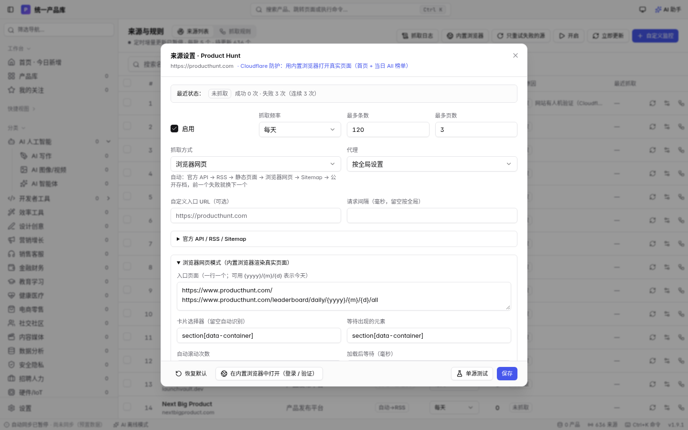
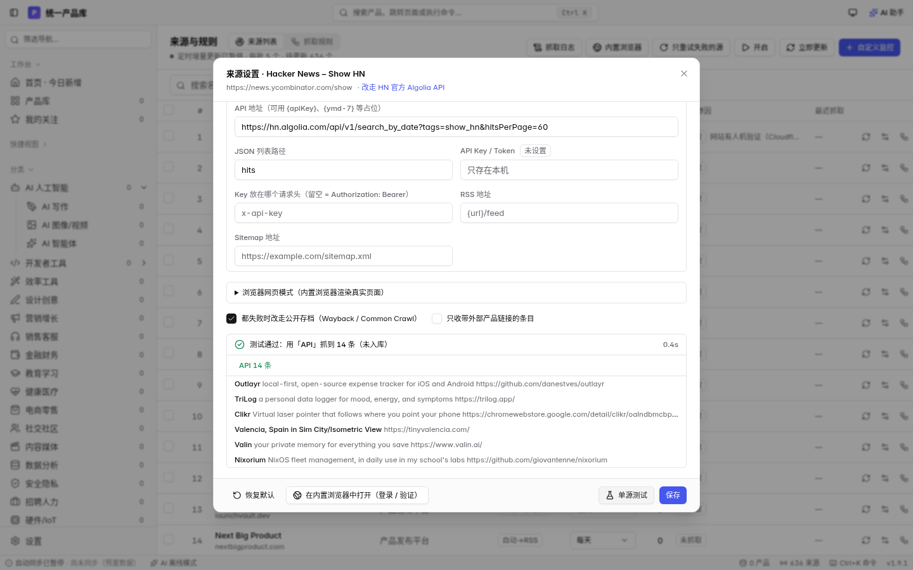

# 产品速查 / 统一产品库

**1.9.2** · 跨平台桌面应用：自动监控 240+ 产品发布与导航网站，抓取新产品入库，去重合并、版本记录、AI 总结与多维分析。

## 下载

当前 GitHub 上**没有**已发布的安装包（无 Release）。打包命令：`npm run dist:win`（以及 `dist:linux` / `dist:mac`）。本轮因磁盘空间不足未打包上传。

## 界面截图

以下为仓库已有真实产品界面（目录名 `screenshots/sources-1.9.1/`，来自 1.9.1 来源/设置相关验收），不是 1.9.2 Windows 安装后的新截图，也不是生成图。仓库目前没有单独的「产品列表主页」截图。


*网络与代理设置 / Network and proxy settings*


*来源列表 / Source list*



*来源设置（Product Hunt） / Source settings (Product Hunt)*



*单源测试（Hacker News） / Single-source test (Hacker News)*

## 功能特性

- 监控 240+ 来源并入库新产品，去重合并、记录版本。
- AI 总结、相似产品检索、复杂筛选、导入导出。
- 可配置网络代理，并对单个来源做连通与抓取测试。
- 提供只读的内部预览网站。

## 技术栈

- TypeScript 桌面应用（见 `package.json`）

## 从源码运行

源码在仓库根目录。当前没有已发布安装包（见上方「下载」）。

```bash
npm install
# 按该目录 README 启动开发或桌面端
```
## 文档
- [更新日志](CHANGELOG.md)
- [使用手册](docs/使用手册.md)
- [设计系统](docs/设计系统.md)

## 贡献

欢迎通过 Issue 和 Pull Request 参与，详见 [CONTRIBUTING.md](CONTRIBUTING.md)。安全问题请按 [SECURITY.md](SECURITY.md) 私下报告。参与时请遵守 [CODE_OF_CONDUCT.md](CODE_OF_CONDUCT.md)。

## 许可证

本仓库尚未附带 LICENSE 文件，许可证未指定。

---

## English

# ProductHub

**1.9.2** · A cross-platform desktop app that watches 240+ product-launch and directory sites, ingests new products, deduplicates them, tracks versions, and adds AI summaries and analysis.

## Download

There is **no** published installer on GitHub Releases. Package with `npm run dist:win` (also `dist:linux` / `dist:mac`). This pass did not build or upload artifacts (disk).

## Screenshots

These are existing real UI captures from `screenshots/sources-1.9.1/` (1.9.1 source/settings acceptance). They are not new 1.9.2 Windows-install shots and not generated artwork. There is no separate “main product catalog” screenshot in the repo yet.


*网络与代理设置 / Network and proxy settings*


*来源列表 / Source list*


*来源设置（Product Hunt） / Source settings (Product Hunt)*


*单源测试（Hacker News） / Single-source test (Hacker News)*

## Features

- Monitors 240+ sources, ingests new products, deduplicates, and records versions.
- AI summaries, similar-product search, advanced filters, and import/export.
- Configurable network proxy, plus per-source connectivity and crawl tests.
- Includes a read-only internal preview site.

## Tech stack

- TypeScript 桌面应用（见 `package.json`）

## Getting started

Source is at the repository root. There is no published installer yet (see Download above).

```bash
npm install
# Start dev or desktop mode as that README describes
```
## Documentation

- [更新日志](CHANGELOG.md)
- [使用手册](docs/使用手册.md)
- [设计系统](docs/设计系统.md)

## Contributing

Issues and pull requests are welcome. See [CONTRIBUTING.md](CONTRIBUTING.md). Please report vulnerabilities privately via [SECURITY.md](SECURITY.md). This project follows [CODE_OF_CONDUCT.md](CODE_OF_CONDUCT.md).

## License

No LICENSE file is included in this repository; the license is unspecified.
