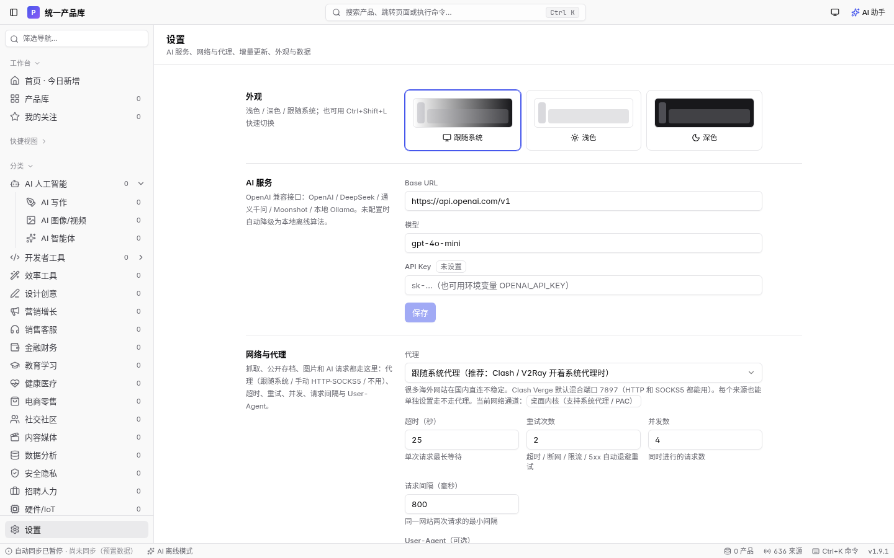
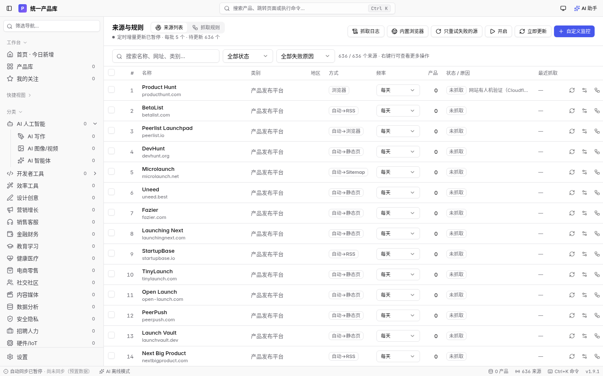

# 产品速查 / 统一产品库

**1.9.2** · 跨平台桌面应用：自动监控 240+ 产品发布与导航网站，抓取新产品入库，去重合并、版本记录、AI 总结与多维分析。

## 界面截图



*网络与代理设置 / Network and proxy settings*



*来源列表 / Source list*


*来源设置（Product Hunt） / Source settings (Product Hunt)*


*单源测试（Hacker News） / Single-source test (Hacker News)*

## 功能特性

- 监控 240+ 来源并入库新产品，去重合并、记录版本。
- AI 总结、相似产品检索、复杂筛选、导入导出。
- 可配置网络代理，并对单个来源做连通与抓取测试。
- 提供只读的内部预览网站。

## 技术栈

- TypeScript 桌面应用（见 `src/ProductHub-1.9.2/package.json`）

## 从源码运行

源码在 `src/ProductHub-1.9.2/`。本仓库不包含安装包。

```bash
cd src/ProductHub-1.9.2
npm install
# 按该目录 README 启动开发或桌面端
```

## 文档

- [源码 README](src/ProductHub-1.9.2/README.md)

---

## English

# ProductHub

**1.9.2** · A cross-platform desktop app that watches 240+ product-launch and directory sites, ingests new products, deduplicates them, tracks versions, and adds AI summaries and analysis.

## Screenshots


*网络与代理设置 / Network and proxy settings*


*来源列表 / Source list*


*来源设置（Product Hunt） / Source settings (Product Hunt)*


*单源测试（Hacker News） / Single-source test (Hacker News)*

## Features

- Monitors 240+ sources, ingests new products, deduplicates, and records versions.
- AI summaries, similar-product search, advanced filters, and import/export.
- Configurable network proxy, plus per-source connectivity and crawl tests.
- Includes a read-only internal preview site.

## Tech stack

- TypeScript 桌面应用（见 `src/ProductHub-1.9.2/package.json`）

## Getting started

Source is under `src/ProductHub-1.9.2/`. This repository does not include installers.

```bash
cd src/ProductHub-1.9.2
npm install
# Start dev or desktop mode as that README describes
```

## Documentation

- [源码 README](src/ProductHub-1.9.2/README.md)

